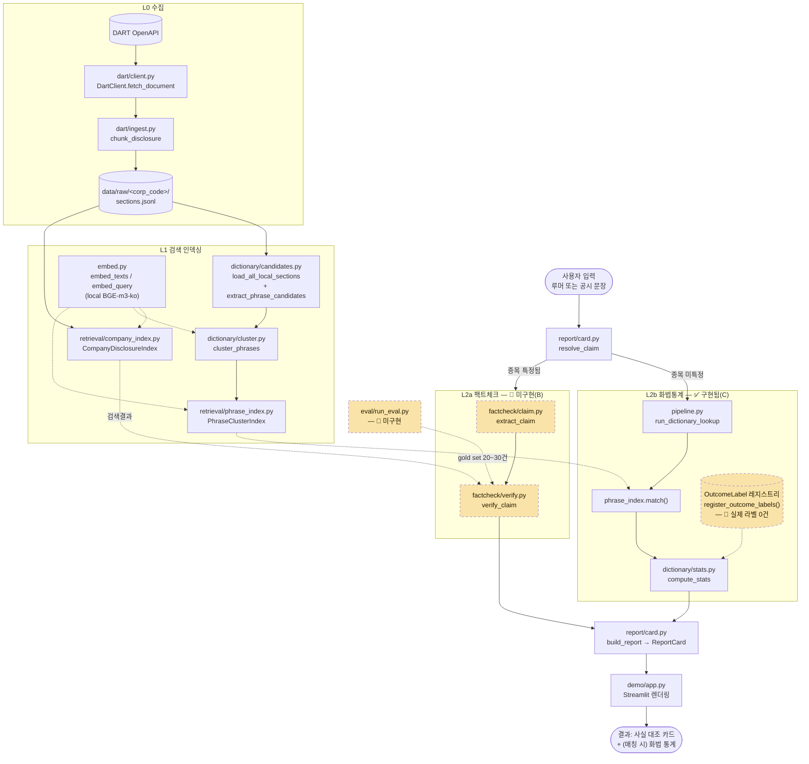

# 08. 시스템 플로우 (System Flow)

> RAG 파이프라인(로딩→청킹→임베딩→인덱싱→검색→생성→평가)을 이 프로젝트의 실제 파일·
> 함수에 대입한 다이어그램. 근거 문서: [DESIGN.md](DESIGN.md) 아키텍처(레이어),
> [01_requirements.md](01_requirements.md), [02_ui_flow.md](02_ui_flow.md).
> **2026-09-14 기준 구현 상태를 그대로 표시**(점선 = 미구현) — 병합될 때마다 낡을 수
> 있으니, 실제 여부는 해당 파일에 `NotImplementedError`가 남아있는지로 재확인할 것.

## 전체 흐름

## 단계별 설명

| 단계 | RAG 개념 | 파일·함수 | 상태 |
| --- | --- | --- | --- |
| 로딩 | Load | `dart/client.py::fetch_document` | ✅ |
| 청킹 | Chunk | `dart/ingest.py::chunk_disclosure` | ✅ |
| 문구 추출 | (전처리) | `dictionary/candidates.py::extract_phrase_candidates` | ✅ |
| 임베딩 | Embed | `embed.py::embed_texts/embed_query` | ✅ (local extra 설치 시) |
| 인덱싱(종목) | Index | `retrieval/company_index.py::CompanyDisclosureIndex` | ✅ |
| 인덱싱(화법) | Index | `retrieval/phrase_index.py::PhraseClusterIndex` | ✅ |
| 검색(종목) | Retrieve | `CompanyDisclosureIndex.search()` | ✅ |
| 검색(화법) | Retrieve | `PhraseClusterIndex.match()` | ✅ |
| 생성(팩트체크) | Generate | `factcheck/verify.py::verify_claim` | 🚧 미구현(B) |
| 생성(화법통계) | Generate | `dictionary/stats.py::compute_stats` | ✅ (단, 라벨 데이터 0건) |
| 조립 | (통합) | `report/card.py::build_report` | ✅ |
| 화면 | (UI) | `demo/app.py` | ✅ |
| 평가 | Evaluate | `eval/run_eval.py` | 🚧 미구현 |

## 두 개의 분기 — 왜 "종목 특정 여부"로 갈리는가

`report/card.py::build_report`가 입력 문장을 보고 하나로 합류시키지 않고 갈라 보내는 이유는
[02_ui_flow.md](02_ui_flow.md) FLOW-001/FLOW-002에 이미 정의돼 있다 — 종목이 특정되면
"그 회사 공시와 대조"가 의미 있고(L2a), 종목이 없으면 "일반적인 화법 패턴"만 의미가
있다(L2b). 두 경로가 만나는 지점이 `ReportCard`(L3) 하나뿐이라, 화면(L4)은 이 카드
하나만 알면 된다.

## 지금 가장 큰 공백

다이어그램에서 점선(🚧)으로 표시된 세 지점 — `factcheck/verify.py`(L2a), `eval/run_eval.py`
(L5), `OutcomeLabel` 레지스트리(라벨 데이터) — 이 세 개가 채워져야 "검색은 잘 되는데
답을 못 만든다"는 지금 상태를 벗어난다. 자세한 담당·우선순위는 [06_open_questions.md](06_open_questions.md)
참고.
