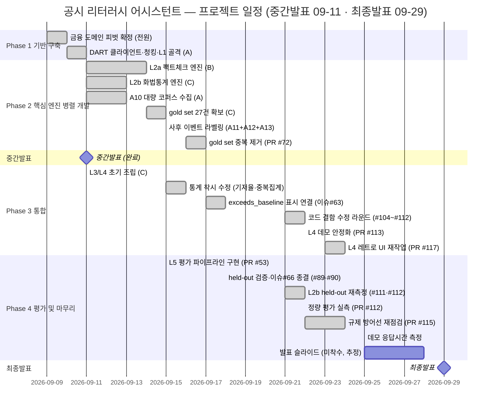

# WBS (작업분류체계)

`docs/DESIGN.md`(레이어 구조)와 `docs/proposals/finance-pivot/03-integrated-proposal.md`
11~12절(팀 분담·Phase)을 작업 단위로 풀어 쓴 문서. **잠금 대상 아님** — 세션마다 진행 상황을
갱신하는 로그 성격이라 CLAUDE.md의 "문서 잠금" 규칙에 해당하지 않는다.

## 1. 작업 분류 (레이어 기준)

```text
공시 리터러시 어시스턴트
├── L0 수집 (A·이승노)
│   ├── DART API 클라이언트 (client.py)
│   ├── 공시서식 분류 + 청킹 (ingest.py)
│   └── 대량 코퍼스 수집 (collect_disclosures.py, A10 오케스트레이터)
├── L1 검색 (C·우지훈)
│   ├── 종목별 하이브리드 검색 (company_index.py)
│   └── 화법 클러스터 인덱스 (phrase_index.py)
├── L2a 팩트체크 (B·김가빈)
│   ├── 클레임 추출 (claim.py)
│   └── claim verification / groundedness guard (verify.py)
├── L2b 화법통계 (C·우지훈)
│   ├── 상투구 클러스터링 (cluster.py)
│   └── 사후 이벤트 통계 (stats.py)
├── L3 통합 리포트 (C·우지훈)
│   └── L2a + L2b 결과 조립 (report/card.py)
├── L4 데모 UI (C·우지훈)
│   ├── 입력·결과 화면 (demo/app.py)
│   └── 레트로 단말기·조회 기록 (demo/terminal.py, demo/history.py)
│       — PR #117로 main 병합(2026-09-24)
└── L5 평가 (횡단, 실작업 C·우지훈 — 원래 담당은 B, DEC-011 참고)
    ├── 팩트체크 gold set (eval/gold_schema.py, eval/gold/)
    └── 클러스터 유의성 평가 (eval/run_eval.py)
```

## 2. Phase별 작업 · 담당 · 완료 기준

| Phase | 작업 | 담당 | 완료 기준 | 상태 (2026-09-25) |
| --- | --- | --- | --- | --- |
| 1. 기반 구축 | DART 키 발급·원문 수집·청킹·종목코드 인덱싱 | A | 종목 1개 최근 공시 검색 가능 | ✅ 완료 |
| 1. 기반 구축 | L2a/L2b 출력 스키마 합의 | B·C | 스키마 문서화 | ✅ 완료 (구현체 존재) |
| 2. 핵심 엔진 병렬 개발 | 상투구 클러스터링 + 사후 이벤트 라벨링 | A | 클러스터 라벨 20개 이상 | ✅ **완료** — PR #55(A11 후보 추출)·#56(A12 라벨링)·#57(A13 배선) 전부 병합(2026-09-15). PR #56 본문 실측: 공시 11,081건 → 라벨 11,081건, 절단 제외 9,418건 판정 가능 중 46.9%(4,414건)가 사후 이벤트 있음. 착수 요청 이슈 #52도 종결 |
| 2. 핵심 엔진 병렬 개발 | L2a claim verification 엔진 | B | 단위 테스트 통과 | ✅ 완료(PR #51 병합) |
| 2. 핵심 엔진 병렬 개발 | gold set 20~30건 수집 | 담당 **B** / 실제 수행 **C**(DEC-011 — DEC-010의 "원래 C" 정정은 번복됨, 3절 참고) | gold set 20건 이상 | ✅ 완료 — PR #53(27건 확장 + `run_eval.py` 구현)·PR #59(사람 검수 24건 반영)에 이어 **PR #72 병합으로 원공시/재공시 중복 2쌍 제거**, 이슈 #61 종결 |
| 2. 핵심 엔진 병렬 개발 | L2b 매칭 검색 skeleton + 데모 UI 와이어프레임 | C | 각자 단위 테스트 통과 | ✅ 완료 (PR #50 병합) |
| 3. 통합 | L2a·L2b → L3 리포트 카드 조립, L4 데모 완성 | C | 엔드투엔드 데모 동작 | ✅ 완료 + 실엔진 연결 후 발견된 통계 착시 2건 수정 반영: PR #62(기저율 보정 — 회계 주석이 착시 일으키던 문제), PR #64(compute_stats 회사 단위 중복 제거, pseudoreplication). PR #65(코퍼스 범위·시기 투명성 캡션)도 병합 |
| 3. 통합 | 통합 중 버그 픽스 | A·B·C | — | ✅ 이번 주 라운드 종료 — PR #49(HTML 표 청킹), #67~#71(L0 안정성·성능), **#104~#112**(검색 keyword_bonus·OpenMP 충돌·LLM 타임아웃·corp_code 경쟁 상태·동점 처리 비결정성·평가 러너). 관련 이슈 #102·#105·#108·#110 전부 종결 |
| 3. 통합 | L4 데모 UI 안정화·재작업 | C | 시연 중 사고 요인 제거 + 화면이 기능을 설명 | ✅ **PR #113 병합**(결과 보존·오류 안내·맥락 지도 이유 표시, B 리뷰 2건 반영) + **PR #117 병합**(2026-09-24, 레트로 '공시 단말기' — 전원 켜기 진입·결과 전용 페이지·프린터 출력·조회 기록, 검증 기록 `docs/testing/` 7건. 승인 리뷰 없이 병합). 외부 공개 전 확인: 조회 기록이 모든 방문자에게 공유됨, 배경 이미지가 제3자 저작물 |
| 4. 평가 및 마무리 | 정밀도·재현율, 클러스터 유의성 측정 | 전원 | 평가 결과표 완성 | ✅ **실측치 확보**(PR #112, L2a는 09-25 재측정) — L2a 재현율 **76.3%**(74.0~80.3%) / hallucination **19.2%**(16.0~22.0%)(gpt-4o-mini, **5회 반복 평균·범위**, 목표 80% 미달). PR #112의 74.3%/17.3%는 1회값이라 이 범위 안의 한 점이었다. PR #115 코드로 쟀고 필터가 버린 사실은 5회 모두 0건 — #115 병합 여부와 무관하게 수치가 같다 · L2b held-out 재현율 **4.0%**(125→5, 3회 연속 동일). 이슈 #66(held-out 검증)은 그보다 앞선 **2026-09-18에 PR #89·#90으로 종결**됐고, 위 4.0%는 그 뒤 PR #111·#112가 다시 측정한 값이다(두 사건을 한 줄로 묶어 적었다가 2026-09-24 분리). ⚠️ L2b 수치는 "클러스터가 미래 사후 이벤트를 예측한다"는 전제가 반증됐음을 뜻하며, 그래서 L4는 예측 주장 없는 재설계(맥락 지도)로 대체됨 |
| 4. 평가 및 마무리 | 규제 방어선 최종 재점검 | 전원 | 팀 리뷰 통과 | 🟡 **코드는 병합, 완료 기준은 미충족** — PR #115가 2026-09-24 병합됐다(잠금 문서 7절 R1~R5 기준 점검 3건: LLM 출력 투자 조언 결정적 필터·그래프 라벨 오독 2건. B 지적 반영, 코퍼스 원문 적중 0회 재측정, PR #116 흡수). 다만 **B의 CHANGES_REQUESTED(09-22)가 해소되지 않은 채** 관리자 병합돼, 완료 기준 "팀 리뷰 통과"는 아직 충족되지 않았다 |
| 4. 평가 및 마무리 | 발표자료 정리 | 전원 | 팀 리뷰 통과 | 🟡 문서(`docs/final-presentation-outline.md`)는 2026-09-24 갱신 완료, **슬라이드는 미착수** |

## 3. 참고

- 이 표의 "상태" 열은 `git log`·`gh pr list`·`gh issue list`를 기준으로 세션 시점에
  스냅샷한 것 — 이후 또 바뀔 수 있다.
  **2026-09-16 정정**: 직전 버전(2026-09-15)이 "L5 작업이 담긴 PR #53이 머지가 아니라
  클로즈되면서 main이 다시 스텁 상태로 돌아갔다"고 적었는데, 이 판단 자체가 스냅샷 시점의
  일시적 상태(리뷰 중 열렸다 닫혔다 하는 과정)를 최종 상태로 오인한 것이었다 — 실제로는
  PR #53이 그 이후 **병합**됐고(`gh pr view 53`으로 `mergedAt` 확인), `run_eval.py`에
  `NotImplementedError`가 하나도 안 남아 있는 것도 직접 grep으로 재확인했다. 즉 "지금 상태를
  다음 세션이 오래된 스냅샷으로 오인하지 않게 하자"는 원래 취지와 반대로, 이 문서 스스로가
  두 번 연속 스냅샷을 최종 결론처럼 적어 틀렸다 — **PR/이슈는 open/merged/closed 상태가
  자주 바뀌므로, 이 문서를 다시 읽는 시점에 `gh pr view <번호>`로 재확인 없이 이 표의
  상태를 사실로 인용하지 말 것.**
- Phase 2 "사후 이벤트 라벨링"(A 담당)은 원안(12절)에서 팀 전체 일정 중 가장 오래 걸리는
  항목으로 우려됐던 병목이었으나, 실제로는 A10이 미리 확보해둔 6개월 관찰 버퍼 덕에 A가
  하루(2026-09-15) 만에 실행까지 끝냈다 — 우려와 달리 크리티컬 패스가 아니었던 것으로 판명.
- **gold set 담당 표기 정정(2026-09-24)**: 이 문서는 그동안 "DEC-010 정정 — 원래 B로
  오기재됐던 것을 C로 바로잡음"이라고 적어 왔는데, **DEC-010은 이미 DEC-011(2026-09-15)로
  번복된 결정**이다. 잠금 문서 `03-integrated-proposal.md` 11~12절 원안에 "B: ... gold set
  수집·검수"라고 명시돼 있어 **담당은 처음부터 B가 맞다**. 다만 실제 작업(PR #53·#59·#72)은
  C가 수행했다 — 지금 와서 재조정하는 게 비효율적이라 그대로 둔 것이다(DEC-011). "담당"과
  "실제 수행자"를 구분해 적는다. 팀 분담을 여러 문서에 중복 기재하면 이런 드리프트가
  반복되니, `CLAUDE.md` 팀 분담 표 하나만 정본으로 참조하는 방향이 낫다.
- **2026-09-24 갱신 시점 확인**: 이전 판에서 "열려 있다"고 적었던 항목은 전부 정리됐다 —
  PR #72 병합, 이슈 #61·#63·#66 종결(`gh pr view`/`gh issue view`로 각각 확인). 열려 있는
  것은 **PR #115**(규제 방어선, 리뷰 대기) · **PR #117**(L4 레트로 UI, 리뷰 대기) ·
  **이슈 #103**(L2b 클러스터링 재설계) 셋뿐이다(이 문서의 PR #118 제외 — 그 뒤 09-24에
  **PR #119**(계층 역방향 의존 해소)가 추가로 열렸다). #103은 "진척이 없는" 게 아니라 **같은 근본
  원인(리터럴 문자열 기준 필터로 클러스터가 경직되는 문제)을 PR #104가 다른 접근으로 이미
  해결**했고(2026-09-22 병합), 이 이슈가 제안한 FAISS ANN 접근이 여전히 필요한지 **재평가만
  남은 상태**다(이슈 #103 코멘트에서 그 재평가를 제안했고 A 응답 대기 중).
  **→ 2026-09-25**: 위의 PR #115·#117·#119와 이후의 #120~#122가 전부 병합돼 열린 PR은 없고,
  열린 이슈는 #103 하나다.
- **PR #116은 PR #115 브랜치 위에 쌓아 올린 탓에 CI가 한 번도 돌지 않았다** — `ci.yml`이
  `pull_request: branches: [main]`이라 main을 대상으로 하지 않는 PR에는 검사가 붙지 않는다.
  2026-09-24에 #116을 #115로 병합해 하나로 합쳤고 그제서야 CI가 실행됐다. **앞으로 PR을
  쌓아 올릴 땐 CI가 돌지 않는다는 점을 감안할 것.**
- **해소됨(2026-09-29)**: 데모 배경으로 쓰던 제3자 저작물 이미지를 **CSS 자체 제작 배경으로
  교체**하고 파일·출처 기록·해당 스크린샷을 모두 제거했다(저장소 공개 준비).
- **데모 응답시간 10초**(`docs/DESIGN.md` 성공지표) — **2026-09-25 측정 완료**, 기록은
  `docs/testing/response-time.md`. 준비된 상태에서 **3~5초로 목표 충족**(대부분 LLM 응답
  대기). 측정 당시 **서버 재기동 후 첫 조회는 5~9분**이었고 그중 약 4분 20초가
  `_cluster_meanings()`였는데, **PR #121에서 그 결과를 디스크에 캐시해 해소**했다
  (실측 123.9초 → 재기동 시 2.6초, 결과 동일). 재기동 후 첫 조회 전체를 다시 재지는
  않았으니 발표 PC에서 한 번 확인할 것 — 안전책은 그대로 "발표 전에 미리 띄우고 한 번
  조회해 두기"다. 자세한 내용은 위 기록 참고.

## 4. 간트차트

실제 확정 일정: **중간발표 2026-09-11**(완료) · **최종발표 2026-09-29**. 기획서 마감일은 없음.
아래 차트에서 **09-24까지는** `git log`·`gh pr list` 기준 실측치이고, 그 이후(리뷰·병합,
응답시간 측정, 슬라이드)는 **추정 일정** — 팀 합의로 확정된 기한이 아니므로 실제 진행
상황에 맞춰 조정 필요.



- **09-25 기준 진행 속도**: 엔진·평가·코드 결함 수정·PR 병합(#115~#122)이 모두 끝나 열린
  PR이 없다. 남은 것은 **발표 준비**(슬라이드)다. 09-16 판에서 추정으로 잡았던 held-out
  검증과 규제 재점검은 실제로 그 무렵 착수돼 일정이 대체로 맞았다.
- 남은 구간에서 일정 위험이 있는 것은 **슬라이드**(미착수, 담당자 가용 시간 미반영)다.
  09-24 판이 우려했던 "리뷰 지연"은 리뷰 없이 관리자 병합하는 것으로 넘어갔다 — 규제
  방어선 행의 "팀 리뷰 통과" 기준은 그래서 여전히 미충족이다.
- 이슈 #103(L2b 클러스터링 재설계)은 발표 범위 밖 후속 과제로 두는 것이 현실적이다 —
  2026-09-21 이후 진척이 없다.
